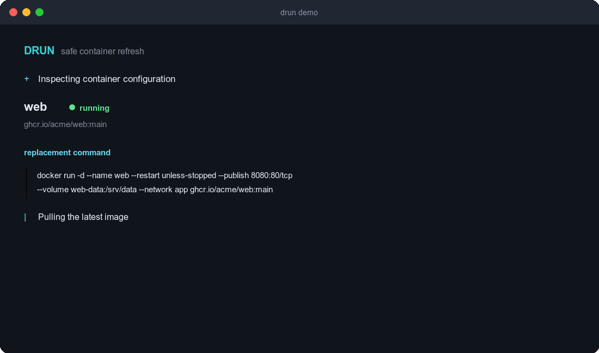

# drun

Safely refresh a Docker container with the latest image while preserving its runtime configuration.

<p align="center">
  
</p>

## Why drun

Updating a one-off Docker container usually means digging through `docker inspect`, rebuilding a long `docker run` command, and hoping nothing was missed. `drun` turns that into one command while keeping the old container available as a rollback point until the replacement is running.

Containers managed by Docker Compose are detected automatically from their standard labels and recreated through `docker compose`; the CLI stays the same and preserves the complete Compose service configuration.

- Pulls the latest version of the configured image
- Compares immutable image IDs and skips containers that are already current
- Shows the exact replacement command before changing the container
- Preserves ports, volumes, environment variables, labels, restart policy, capabilities, networks, entrypoint, user, working directory, and common security options
- Restores the original standalone container automatically when replacement fails
- Shows every container in one live table: check progress, version changes, and per-container update status
- Finishes an in-progress replacement safely when interrupted with Ctrl+C
- Supports non-interactive automation and plain-text output

## Install

A working Docker CLI is required. Install the latest prebuilt binary on Linux or macOS:

```bash
curl -fsSL https://raw.githubusercontent.com/abcdlsj/drun/main/install.sh | sh
```

The installer supports Linux and macOS on `amd64` and `arm64`. It verifies the release checksum before installing to `/usr/local/bin`.

Install a specific version or choose another directory:

```bash
curl -fsSL https://raw.githubusercontent.com/abcdlsj/drun/main/install.sh | \
  DRUN_VERSION=v0.1.0 DRUN_INSTALL_DIR="$HOME/.local/bin" sh
```

With Go 1.24 or later, you can also install from source:

```bash
go install github.com/abcdlsj/drun@latest
```

Or build the repository locally:

```bash
git clone https://github.com/abcdlsj/drun.git
cd drun
go build -o drun .
```

## Usage

```console
$ drun [options]
$ drun [options] <container_name>
$ drun check [options]
$ drun version
```

Common workflows:

```bash
# Find available updates and choose containers interactively
drun

# Update every container with an available image
drun --yes

# Preview the reconstructed command without pulling or changing anything
drun --dry-run my-web-app

# Refresh interactively
drun my-web-app

# Skip confirmation in automation
drun --yes my-web-app

# Disable colors and animated rendering
drun --no-color my-web-app

# The explicit check command remains available for compatibility
drun check
```

| Option | Description |
| --- | --- |
| `--dry-run` | Inspect and print the replacement command without making changes |
| `-y`, `--yes` | Skip confirmation for one container, or update every available container when scanning |
| `--no-color` | Disable color and interactive rendering |
| `-v`, `--version` | Print version information |

Set the standard `NO_COLOR` environment variable to disable color as well.

Running `drun` without a container scans every running container for updates. `drun check` is an equivalent compatibility command. Each running container appears in one table with its image and status: available update, up to date, skipped (local image, digest pin, or `--rm`), or failed. No updates are selected by default: use the arrow keys to move, Space to toggle an item, `a` to select or clear all, and Enter to update the selection. While updating, the table follows each selected container through its replacement steps.

Checking for updates pulls each unique remote image once, but it does not stop or replace any container until the selection is confirmed. Locally built images and images pinned by digest are skipped. Running Docker Compose containers are detected from their standard labels and marked as `compose` in the update list. Replicas of the same Compose service are grouped and recreated with one `docker compose up`. Single-container refreshes print the exact `docker compose up` command before confirmation; batch updates keep the output compact. Stopped or not-yet-created Compose services are not discovered. In non-interactive output, `drun` only lists updates unless `--yes` is supplied.

## Safe replacement

`drun` deliberately delays destructive work until after the image pull and confirmation:

1. Inspect the container and its current immutable image configuration.
2. Pull the configured image and compare image IDs.
3. Exit without touching the container when the image is already current.
4. Detect Docker Compose ownership, otherwise reconstruct only container-level overrides, and print the exact replacement command.
5. Ask for confirmation unless `--yes` is set.
6. For standalone containers, stop the current container and rename it to a temporary rollback name.
7. Start the replacement (or delegate it to Compose), verify its image ID, and reconnect additional networks when needed.
8. Remove the standalone rollback container only after every verification succeeds.

If startup or network attachment fails, `drun` removes the partial replacement, restores the original name, and restarts the original container when it was previously running.

Ctrl+C cancels image checks right away. Once a replacement has started, `drun` lets it finish (or roll back), then stops before the next container.

For Docker Compose services, `drun` delegates recreation to `docker compose up --no-deps` using the project metadata attached to the container. Compose owns the replacement lifecycle in this path, so `drun` verifies the resulting image but cannot provide its standalone-container rollback mechanism.

## Configuration coverage

The reconstructed container includes runtime overrides without pinning defaults from the old image:

- Container name and image
- Environment variables and labels that differ from the old image defaults
- Bind mounts, named volumes, anonymous volumes, and `--mount` bind, volume, and tmpfs mounts
- Published ports, including host IP bindings
- Restart policy, including `on-failure` retry count
- Primary and additional networks with user-defined aliases and static IP addresses
- Custom hostname and domain name, plus exposed ports beyond the image defaults
- Overridden user, working directory, entrypoint, command, stop signal, stop timeout, and healthcheck
- Capabilities, security options, DNS, extra hosts, and supplementary groups
- Privileged, read-only root filesystem, init, shared memory, tmpfs, publish-all, TTY, and interactive settings
- Memory, CPU, PID, and OOM limits, ulimits, and sysctls
- Devices, GPU requests, log driver and options, runtime, IPC, PID, UTS, and cgroup parent

Containers created with `--rm` are rejected because Docker deletes them when stopped, which makes a reliable rollback impossible.

## Development

```bash
go test -race ./...
go vet ./...
go build ./...
```

Regenerate the README animation with [VHS](https://github.com/charmbracelet/vhs). The script records the real binary against a stand-in `docker` from `scripts/demo`, so no Docker daemon is needed:

```bash
./scripts/generate-demo.sh
```

## Release

GitHub Actions publishes a release when a semantic version tag is pushed. The release contains checksum-verified archives for Linux and macOS on `amd64` and `arm64`.

```bash
git tag -a v0.2.0 -m "v0.2.0"
git push origin v0.2.0
```

The tag version is embedded in release binaries. Builds installed with `go install` use the Go module version. Run `drun version`, `drun -v`, or `drun --version` to print it. CI runs automatically for pushes to `main` and for pull requests.
